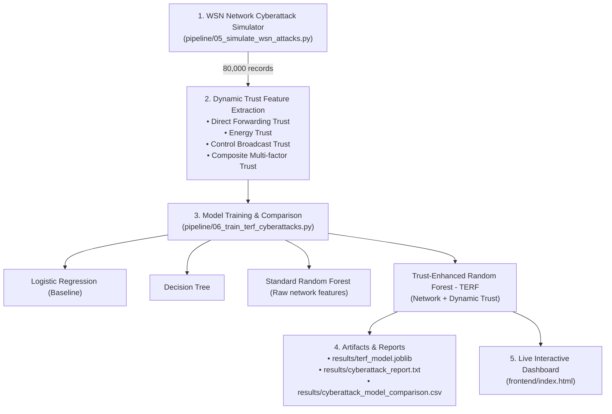

# TERF: Trust-Enhanced Intrusion & Anomaly Detection for WSNs

This repository provides an end-to-end framework for **Anomaly Detection and Security Enhancement in Wireless Sensor Networks (WSNs)**. It combines:
1. **Network Cyberattack Intrusion Detection (TERF - Trust-Enhanced Random Forest)** based on the **WSN-DS** benchmark dataset.
2. **Sensor-Health & Data Quality Detection** using an unsupervised dense Autoencoder baseline + physical sensor domain rules.

---

## System Architecture & Pipeline Workflow



---

## 1. Dataset Origin & Cyberattack Specifications (WSN-DS)

The cyberattack simulation and intrusion detection framework in this project are based on the **WSN-DS (Wireless Sensor Network Dataset for Intrusion Detection)** benchmark.

* **Original Research Paper:**
  > Almomani, I., Al-Kasasbeh, B., & Al-Akhras, M. (2016). *“WSN-DS: A Dataset for Intrusion Detection Systems in Wireless Sensor Networks.”* Journal of Sensors, Volume 2016, Article ID 4731953. [doi:10.1155/2016/4731953](https://doi.org/10.1155/2016/4731953)
* **Official Kaggle Distribution:** [https://www.kaggle.com/datasets/bassamkasasbeh1/wsnds](https://www.kaggle.com/datasets/bassamkasasbeh1/wsnds) (by Dr. Bassam Al-Kasasbeh).
* **Protocol Environment:** Simulated in **NS-2 (Network Simulator 2)** using the **LEACH (Low-Energy Adaptive Clustering Hierarchy)** routing protocol with 100 wireless sensor nodes.

### The 4 Specific Cyberattacks in WSN-DS

WSN-DS is a unified tabular dataset containing **Normal traffic** alongside **4 specific routing/DoS cyberattacks**:

| Attack Category | Mechanism in WSN-DS Paper | Implementation in [`pipeline/05_simulate_wsn_attacks.py`](pipeline/05_simulate_wsn_attacks.py) |
| :--- | :--- | :--- |
| **1. Normal** | Nodes form clusters periodically, send data to their Cluster Head (CH), and conserve battery power. | Forwarding ratio $90\%–98\%$, realistic Beta-distributed wireless background loss ($2\%–15\%$), normal energy depletion. |
| **2. Blackhole** | A compromised node advertises optimal zero-cost routing, attracts traffic from member nodes, and **silently drops 100% of received data packets**. | `DATA_D` (Dropped) $\approx 92\%–100\%$, `DATA_F` (Forwarded) $\approx 0$. Direct Trust collapses to $\approx 0.04$. |
| **3. Grayhole** *(Selective Forwarding)* | The attacker selectively drops $30\%–60\%$ of data packets to disrupt communication while evading naive packet-drop thresholds. | `DATA_D` between $28\%–62\%$. Mimics congested channel loss to specifically evaluate whether TERF's trust evaluation layer exposes it. |
| **4. Flooding** | During cluster setup, the attacker broadcasts massive bursts of fake Advertisement (`ADV`) and Join (`JOIN`) control packets to exhaust neighbor buffers and battery. | Control packet count spikes ($45–200$ control packets/round), buffer overflow drops, rapid battery drain ($0.40–0.85$ J). Control Trust collapses to $\approx 0.08$. |
| **5. Scheduling** *(TDMA)* | In the steady-state transmission phase, the attacker transmits outside its designated TDMA time slot, colliding with legitimate member nodes. | Broadcasts out of slot, causing channel contention, desynchronization, and elevated collision rates ($16\%–38\%$). |

---

## 2. Feature Schema (Direct WSN-DS Mapping)

The dataset generated by [`pipeline/05_simulate_wsn_attacks.py`](pipeline/05_simulate_wsn_attacks.py) reproduces the exact 15 network features of the WSN-DS paper:

| Feature Name | Description under LEACH Protocol |
| :--- | :--- |
| `Node_ID` | Sensor node identifier ($1$ to $100$) |
| `Time` | Simulation timestamp (seconds) |
| `Is_CH` | Binary flag ($1$ if Cluster Head, $0$ if Member Node) |
| `who_CH` | ID of the node's assigned Cluster Head |
| `Dist_To_CH` | Distance between node and Cluster Head |
| `Rank` | Routing order/depth in tree |
| `ADV_S` / `ADV_R` | Advertisement packets Sent / Received (cluster formation) |
| `JOIN_S` / `JOIN_R` | Join Request packets Sent / Received by Cluster Head |
| `SCH_S` / `SCH_R` | TDMA Schedule packets Sent / Received |
| `DATA_S` | Data packets generated and sent by the node |
| `DATA_R` | Transit data packets received from other nodes |
| `DATA_F` | Data packets successfully forwarded toward the sink |
| `DATA_D` | Data packets dropped (attack, queue overflow, or collision) |
| `Energy` | Current remaining battery energy (Joules, max 2.0J) |
| `Attack_Type` | Ground-truth label: `Normal`, `Blackhole`, `Grayhole`, `Flooding`, `Scheduling` |

---

## 3. Dynamic Trust Score Formulation (TERF)

From raw WSN packet metrics, 4 dynamic trust scores are calculated to augment the machine learning feature space:

1. **Direct Forwarding Trust:**
   $$\text{Direct Trust} = \frac{\text{DATA\_F}}{\text{DATA\_R} + \epsilon}$$
   *(Normal: $\approx 0.93$; Grayhole: $\approx 0.55$; Blackhole: $\approx 0.04$)*

2. **Energy Trust:**
   $$\text{Energy Trust} = \frac{\text{Residual Energy}}{\text{Initial Energy}}$$

3. **Control Quota Trust:**
   $$\text{Control Trust} = 1.0 - \left(\frac{\text{Control Packets}}{\text{Total Packets}} \times 1.6\right)$$
   *(Normal: $\approx 0.91$; Flooding: collapses to $\approx 0.08$)*

4. **Composite Trust (TERF Multi-factor Fusion):**
   $$\text{Composite Trust} = 0.50 \times \text{Direct Trust} + 0.30 \times \text{Control Trust} + 0.20 \times \text{Energy Trust}$$

---

## 4. Benchmark Performance: Standard RF vs. TERF

Evaluated on 16,000 held-out test records (80/20 stratified split of 80,000 simulated WSN-DS records):

| Model | Feature Set | Accuracy | Macro Recall | Macro F1 | Normal FPR | Inference Latency |
| :--- | :--- | :---: | :---: | :---: | :---: | :---: |
| **Logistic Regression** | Raw Network (15 features) | 99.48% | 99.27% | 99.28% | 0.37% | 0.0004 ms |
| **Decision Tree** | Raw Network (15 features) | 99.49% | 99.49% | 99.29% | 0.50% | 0.0001 ms |
| **Standard Random Forest** | Raw Network (15 features) | 99.47% | 99.42% | 99.27% | 0.48% | 0.0039 ms |
| **Trust-Enhanced RF (TERF)** | **Network + Trust Scores** | **99.62%** | **99.78%** | **99.48%** | **0.47%** | **0.0031 ms** |

### Per-Class Detection of Stealthy Attacks:
* **Grayhole Detection (Standard RF):** Recall = **97.58%**, F1 = **96.71%**
* **Grayhole Detection (TERF):** Recall = **99.38%**, F1 = **97.66%**  
  *(+1.8% recall gain because Direct Trust separates selective packet loss from normal channel collisions)*
* **Blackhole Detection:** **100.0%** Precision & Recall
* **Flooding Detection:** **100.0%** Precision & Recall
* **Scheduling/TDMA Detection:** **100.0%** Precision & Recall

---

## 5. Directory Structure

```text
.
├── docs/
│   └── architecture.md            # Architectural breakdown of sensor & network detectors
├── frontend/
│   ├── index.html                 # Live interactive dashboard (Cyberattack & Sensor modes)
│   └── server.py                  # Zero-dependency local web server
├── pipeline/
│   ├── 01_train_autoencoder.py    # Autoencoder baseline training on sensor data
│   ├── 02_fault_injection.py      # Sensor fault injection benchmark
│   ├── 03_decision_layer_eval.py  # Decision layer evaluation vs. AE baseline
│   ├── 04_full_pipeline.py        # End-to-end sensor anomaly pipeline & report
│   ├── 05_simulate_wsn_attacks.py # Protocol-level WSN cyberattack simulator (WSN-DS specification)
│   └── 06_train_terf_cyberattacks.py # Model comparison & TERF training pipeline
├── results/                       # Generated datasets, model artifacts, and evaluation reports
│   ├── wsn_attack_simulation.csv  # 80,000 simulated WSN records with trust scores
│   ├── terf_model.joblib          # Trained TERF model artifact
│   ├── cyberattack_report.txt     # Benchmark summary report
│   ├── cyberattack_model_comparison.csv # Cross-model metrics
│   ├── cyberattack_per_class_metrics.csv # Per-attack class breakdown
│   ├── report.txt                 # Sensor-health baseline report
│   ├── results.csv
│   └── results_combined.csv
└── requirements.txt               # Python package dependencies
```

---

## 6. Environment Setup & Execution

### Setup Environment
```bash
cd /home/aditya-2274/terf_deliverable
source .venv/bin/activate
pip install -r requirements.txt
```

### Run Cyberattack Simulation & Train TERF
```bash
# 1. Simulate the WSN cyberattacks and calculate trust scores:
python3 pipeline/05_simulate_wsn_attacks.py

# 2. Train baseline models and TERF:
python3 pipeline/06_train_terf_cyberattacks.py
```

### Run Sensor-Health Baseline Pipeline
```bash
# Autoencoder baseline training & persistence decision layer:
python3 pipeline/01_train_autoencoder.py

# End-to-end sensor anomaly benchmark:
python3 pipeline/04_full_pipeline.py
```

### Run Live Interactive Web Console
```bash
python3 frontend/server.py 8000
```
Open **[http://localhost:8000](http://localhost:8000)** in your browser:
* **Toggle Modes:** Switch between **🛡️ Cyberattack Mode (TERF)** and **📡 Sensor-Health Mode (Autoencoder)**.
* **Attack Injection:** Interactively trigger **Normal**, **Blackhole**, **Grayhole**, **Flooding**, or **Scheduling** attacks.
* **Live Trust Meters:** Observe Direct Trust, Control Trust, and Composite Trust adapt in real time.
* **Defense Policy:** View instant node classification and automated quarantine (**Authorized** $\rightarrow$ **Suspicious** $\rightarrow$ **Isolated Malicious Node**).

---

## 7. Plugging in the Real Kaggle WSN-DS CSV

To use the official pre-compiled Kaggle file instead of the built-in simulator:
1. Download `WSN-DS.csv` from [Kaggle](https://www.kaggle.com/datasets/bassamkasasbeh1/wsnds).
2. Place it in `results/wsn_attack_simulation.csv`.
3. Re-run:
   ```bash
   python3 pipeline/06_train_terf_cyberattacks.py
   ```
   The training pipeline will directly ingest the official Kaggle dataset and evaluate TERF without requiring code modifications.
