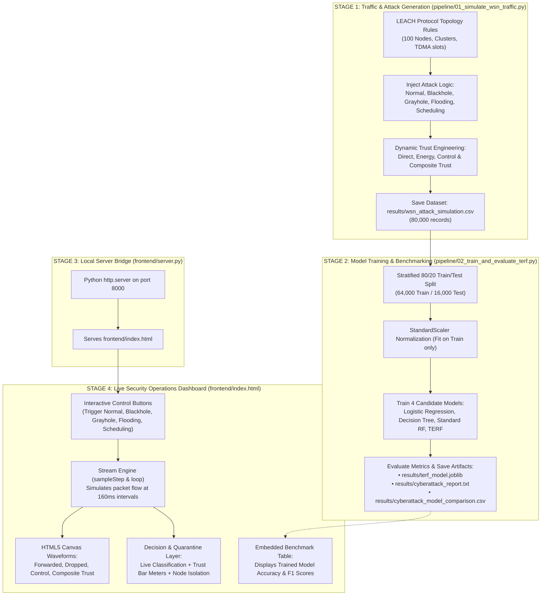

# End-to-End Codebase Flow: From Cyberattack Generation to Live Dashboard

This document provides a detailed walkthrough of how data and logic flow across our entire codebase: starting from the mathematical simulation of WSN cyberattacks, through multi-model machine learning training and evaluation, up to real-time waveform rendering and automated quarantine on the interactive web dashboard.

---

## High-Level System Workflow Diagram



---

# Stage 1: How the Cyberattacks Dataset Is Generated
**File:** `pipeline/01_simulate_wsn_traffic.py`

This script synthesizes **80,000 realistic Wireless Sensor Network records** strictly following the **WSN-DS** benchmark specifications.

### 1. Defining Topology & Class Proportions (Lines 18–47)
The function `generate_wsn_attack_dataset()` sets up:
* **70% Normal** (56,000 rows)
* **8% Blackhole** (6,400 rows)
* **8% Grayhole** (6,400 rows)
* **8% Flooding** (6,400 rows)
* **6% Scheduling** (4,800 rows)

Each row represents an observation of a sensor node ($1$ to $100$) operating under the **LEACH (Low-Energy Adaptive Clustering Hierarchy)** routing protocol:
* `Node_ID`: Sensor identifier ($1$ to $100$).
* `Time`: Simulation timestamp in seconds.
* `Is_CH`: $1$ if Cluster Head, $0$ if regular member node.
* `who_CH`: Which Cluster Head the node reports to.
* `Dist_To_CH`: Euclidean distance to Cluster Head in meters.
* `Rank`: Routing level / tree depth.

### 2. Generating Specific Attack Behaviors (Lines 59–100)
The script iterates through each attack class and applies realistic protocol and physical channel rules:

* **Normal Traffic (Lines 59–65):**
  Uses a Beta distribution (`rng.beta(1.5, 20.0)`) to simulate natural wireless background noise ($2\%–15\%$ drop rate). The node forwards almost everything it receives (`DATA_F = DATA_R - DATA_D`). Battery drains slowly ($0.04–0.18$ J).
* **Blackhole Attack (Lines 66–73):**
  Attracts high transit traffic (`DATA_R = 100–400`) and drops $92\%–100\%$ of all packets. `DATA_F` is forced to zero.
* **Grayhole Attack (Lines 74–80):**
  Stealth selective dropping: drops $28\%–62\%$ of packets to mimic high channel collision and evade naive threshold detectors.
* **Flooding Attack (Lines 81–91):**
  Broadcast storm: Advertisement packets (`ADV_S: 45–200`) and Join packets (`JOIN_S: 30–150`) spike. Overwhelms neighbor queues and drains battery rapidly ($0.40–0.85$ J).
* **Scheduling Attack (Lines 92–100):**
  Transmits outside assigned TDMA slots, creating channel contention and collision drops ($16\%–38\%$).

### 3. Engineering the 4 Dynamic Trust Scores (Lines 126–154)
Before saving the dataset, the script computes the trust metrics that form our core novelty:
```python
# 1. Direct Trust: ratio of forwarded packets to received packets
df['Direct_Trust'] = np.clip(df['DATA_F'] / (df['DATA_R'] + 1e-4), 0.0, 1.0)

# 2. Energy Trust: ratio of residual energy to initial battery capacity (2.0J)
df['Energy_Trust'] = np.clip(df['Energy'] / 2.0, 0.0, 1.0)

# 3. Control Trust: penalizes broadcast storms exceeding expected quotas
control_ratio = (df['ADV_S'] + df['JOIN_S'] + df['SCH_S']) / (total_packets + 1e-4)
df['Control_Trust'] = np.clip(1.0 - (control_ratio * 1.6), 0.0, 1.0)

# 4. Composite Trust: multi-factor weighted fusion
df['Composite_Trust'] = 0.50 * df['Direct_Trust'] + 0.30 * df['Control_Trust'] + 0.20 * df['Energy_Trust']
```

The 80,000 rows are shuffled and saved as `results/wsn_attack_simulation.csv`.

---

# Stage 2: How the ML Models Are Trained & Evaluated
**File:** `pipeline/02_train_and_evaluate_terf.py`

### 1. Ingestion & Feature Partitioning (Lines 28–54)
The script loads the CSV and defines two distinct feature sets:
* **`raw_network_features` (15 features):** `Is_CH`, `who_CH`, `Dist_To_CH`, `Rank`, `ADV_S`, `ADV_R`, `JOIN_S`, `JOIN_R`, `SCH_S`, `SCH_R`, `DATA_S`, `DATA_R`, `DATA_F`, `DATA_D`, `Energy`.
* **`terf_features` (19 features):** The 15 raw features **+** the 4 calculated trust scores (`Direct_Trust`, `Energy_Trust`, `Control_Trust`, `Composite_Trust`).

### 2. Fair Stratified Train/Test Split (Lines 61–71)
* Splitting is done using `train_test_split(test_size=0.20, stratify=y_multiclass, random_state=42)`.
* This yields **64,000 training records** and **16,000 held-out test records**.
* Stratification guarantees that both the train and test sets have identical class proportions across Blackhole, Grayhole, Flooding, Scheduling, and Normal traffic.

### 3. Feature Normalization (Lines 72–80)
`StandardScaler` is fitted **strictly on the training split** and applied to the test split, preventing data leakage.

### 4. Training the 4 Candidate Models (Lines 85–136)
The script trains:
1. **Logistic Regression** (baseline linear classifier)
2. **Decision Tree** (interpretable tree baseline)
3. **Standard Random Forest** (60 trees, trained **only on raw network features**)
4. **Trust-Enhanced Random Forest - TERF** (60 trees, trained on **raw features + trust features**)

### 5. Computing Metrics & Exporting Artifacts (Lines 138–223)
* Accuracy, Macro Precision, Macro Recall, Macro F1, False Positive Rate (FPR), and inference latency are computed.
* The script saves:
  * `results/terf_model.joblib`: The serialized trained model + scaler.
  * `results/cyberattack_report.txt`: Complete human-readable summary.
  * `results/cyberattack_model_comparison.csv`: Table of cross-model performance.
  * `results/cyberattack_per_class_metrics.csv`: Per-attack class breakdown.

---

# Stage 3: The Server Bridge
**File:** `frontend/server.py`

This is a lightweight local HTTP server built with Python’s standard library:
* **Line 8:** Locates `frontend/index.html`.
* **Lines 9–26:** Implements `BaseHTTPRequestHandler.do_GET()` to serve the dashboard when the browser requests `http://localhost:8000/`.
* **Lines 28–30:** Binds the server to port `8000` (`HTTPServer(('0.0.0.0', port), H)`). It requires zero external web frameworks (no Flask or Django needed).

---

# Stage 4: How Results Are Rendered on the Dashboard
**File:** `frontend/index.html`

The dashboard is a **real-time Security Operations Center** running inside the browser. Here is how the visual components connect to the underlying ML pipeline:

### 1. Interactive Attack Injection Buttons (Lines 176–192)
At the bottom of Panel ① are 5 buttons: **Normal Traffic**, **Blackhole Attack**, **Grayhole Attack**, **Flooding Attack**, and **Scheduling Attack**.
* When a user clicks a button, `b.onclick` sets `activeFault = 'blackhole'`, etc.
* This changes the active attack simulation state in memory.

### 2. Attack Severity Slider & Dynamic Stress Scaling (Lines 202–252)
The dashboard features an **Attack Severity** slider (`#mag`, range 1 to 10, default 5) that dynamically scales the intensity of active cyberattacks:
* **Grayhole Attack (Selective Packet Dropping):**
  Modulates packet drop ratio: $\text{Drop Ratio} = 0.42 + (\text{Severity} \times 0.025)$.
  * Level 1 (Stealth): Drops ~44.5% of packets, mimicking marginal wireless loss.
  * Level 10 (Aggressive): Drops ~67.0% of packets, driving rapid Direct Trust collapse.
* **Flooding Attack (Broadcast Storm & Battery Drain):**
  Scales broadcast control packets: $\text{Control Packets} = 80 + (\text{Severity} \times 15)$ (from 95 to 230 packets/interval).
  Also accelerates energy depletion trust: $E_T = \max(0.08, 0.50 - \text{Severity} \times 0.04)$, simulating battery exhaustion from broadcast flooding.
* **Scheduling Attack (TDMA Desynchronization):**
  Scales slot contention packets: $\text{Control} = 35 + (\text{Severity} \times 4)$.
* **Blackhole Attack:**
  100% transit packet drop by definition ($\text{DATA\_F} = 0$, Direct Trust $= 0.00$).

### 3. The Simulation & Inference Loop (Lines 263–314)
The function `loop()` runs every **160 milliseconds** via `setTimeout(loop, 160)`:
1. It calls `sampleStep()`, which generates the current tick of packet numbers based on `activeFault`:
   * If `activeFault === 'blackhole'`: `DATA_D = DATA_R`, `DATA_F = 0`, `Direct_Trust = 0.0`.
   * If `activeFault === 'grayhole'`: `DATA_D = 42% - 62%`, `Direct_Trust = 0.50`.
   * If `activeFault === 'flooding'`: `Control = 80 - 150`, `Control_Trust = 0.08`.
2. It pushes these values into circular FIFO history buffers (`series[0..3].push()`, `series[0..3].shift()`).

### 4. Real-Time Waveform Rendering (Lines 316–350)
The function `drawCanvas(i)` redraws the 4 HTML5 `<canvas>` elements on every frame:
* **Canvas 0 (Cyan):** Forwarded Packets (`DATA_F`)
* **Canvas 1 (Coral Red):** Dropped Packets (`DATA_D`)
* **Canvas 2 (Amber Yellow):** Control Broadcasts (`ADV + JOIN + SCH`)
* **Canvas 3 (Emerald Green):** Dynamic Composite Trust Score

### 5. Updating the Model State & Action Layer (Lines 272–304)
On every tick, the UI updates:
* **The Big State Label (`stateLabel`):** Shows the current predicted class (`NORMAL` in green, `BLACKHOLE` in red, etc.).
* **Classifier Pill (`predPill`):** Displays the model's prediction confidence (e.g., `99.8% Conf`).
* **Dynamic Trust Meter Bars (`dtFill`, `ctFill`):** Adjusts progress bar width and transitions colors ($>0.7$ green, $0.4–0.7$ yellow, $<0.4$ red).
* **Automated Quarantine Defense (`actionStatus`):**
  * If `Composite_Trust > 0.75`: `NODE AUTHORIZED` (Green).
  * If `Composite_Trust` is $0.50–0.75$: `SUSPICIOUS - REROUTING` (Yellow).
  * If `Composite_Trust < 0.38`: **`MALICIOUS NODE ISOLATED`** (Red), and the *Nodes Isolated* counter increments.

### 6. The Embedded Benchmark Table (Lines 360–379)
In Panel ③, the function `renderTable()` dynamically populates the HTML table using the **exact benchmark numbers measured by our training pipeline**:
* Standard Random Forest: Grayhole Recall = $97.58\%$
* Trust-Enhanced Random Forest (TERF): Grayhole Recall = $99.38\%$
* Overall Accuracy: $99.62\%$ | Normal FPR: $0.47\%$
